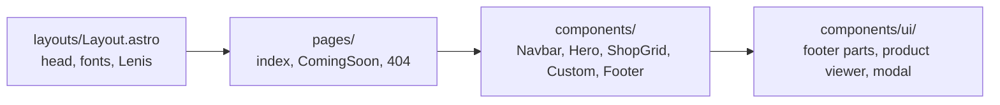

<div align="center">

# Aura Store

**Clothes without excess.**

Static e-commerce landing page for a clothing brand, built with Astro, React and Tailwind CSS. It ships as plain HTML with small interactive islands. It needs no backend, no database and no API keys.

[](https://astro.build)
[](https://react.dev)
[](https://tailwindcss.com)
[](https://www.typescriptlang.org)

</div>

---

**Table of contents**

- [Description](#description)
- [Features](#features)
- [Architecture](#architecture)
- [Getting started](#getting-started)
- [Scripts](#scripts)
- [Quality and tests](#quality-and-tests)
- [Deployment](#deployment)
- [Project structure](#project-structure)
- [Documentation](#documentation)
- [Contributing](#contributing)
- [License](#license)

## Description

Aura Store is a single-page storefront for a fictional clothing brand. The home page presents a hero, a seasonal shop grid, a product viewer and a footer, and the secondary pages are placeholders. Product data is hardcoded in `src/components/ShopGrid.tsx` and `src/components/Custom.tsx`, so the site is fully static: `pnpm build` produces HTML, CSS and assets, and nothing runs on a server at request time.

## Features

| Area | What it offers |
| --- | --- |
| Hero | Full-height brand hero with the name split across the viewport, a product image and a "New Collection" link to `/ComingSoon` |
| Shop | Four products. Hovering a card (or tapping it on touch screens) reveals the back view with a scan-line transition. Clicking a card opens `/ComingSoon` |
| Custom | Product viewer with three items. Switching items plays a glitch transition, the image tilts in 3D with the pointer, and a specification sheet updates |
| Navigation | Fixed navbar with desktop links and a mobile menu below the `md` breakpoint. About and Contact link to `/ComingSoon` |
| Footer | Barcode, batch information, a link grid with selectable rows, a ticker and a legal line. The cut-line control opens a modal |
| Placeholder pages | `/ComingSoon` for sections not built yet, and a custom 404 page for unknown URLs |
| Motion | Smooth scrolling with Lenis, with an offset for the fixed navbar. Animations are reduced when the user prefers reduced motion |

## Architecture



- **Pages compose sections and do not hold UI logic.** Every page wraps its content in `Layout.astro`, which sets the document head, the font preloads and the smooth-scroll setup.
- **Only interactive components are hydrated.** `Navbar`, `ShopGrid`, `Custom` and `Footer` use `client:load` in `pages/index.astro`. `Hero` has no state, so it ships as static HTML. Keeping the rest static keeps the first paint fast.
- **`ui/` components do not import sections.** They are reusable parts that sections compose, which keeps the dependency direction one-way and avoids import cycles.

## Getting started

**Requirements**

- Node.js 22.12 or newer (`engines` in `package.json`).
- pnpm. The project is locked with `pnpm-lock.yaml`, so use pnpm rather than npm.

This project needs no environment variables and no API keys.

```bash
pnpm install
pnpm dev   # http://localhost:4321
```

## Scripts

| Command | Description |
| --- | --- |
| `pnpm dev` | Starts the Astro dev server at `http://localhost:4321` |
| `pnpm build` | Builds the static site to `dist/` |
| `pnpm preview` | Serves the `dist/` build locally, to check it before deploying |
| `pnpm astro` | Runs the Astro CLI, for example `pnpm astro -- --help` |
| `pnpm test:e2e` | Runs the Playwright end-to-end tests in `e2e/` against the production build |

## Quality and tests

The end-to-end suite lives in `e2e/` and runs with Playwright on desktop and mobile projects. It builds the site and serves `dist/` before running. There is no linter configuration yet. The CI workflow in `.github/workflows/ci.yml` runs on pull requests to `dev` and `main` with `pnpm install --frozen-lockfile` and `pnpm build`; running the end-to-end suite in CI is a separate change.

## Deployment

The site is deployed on Vercel. `vercel.json` pins the install and build commands:

- Install: `pnpm install --frozen-lockfile`
- Build: `pnpm build`
- Output: `dist/`

Astro generates `404.html` from `src/pages/404.astro`, so unknown URLs render the custom 404 page.

To check the production build locally:

```bash
pnpm build
pnpm preview
```

## Project structure

```text
.
├── .github/                 # CI workflow, Dependabot config and pull request template
├── public/                  # Static files served as they are
│   ├── fonts/               # Montserrat and Syne variable fonts
│   └── thumbs/              # Shop thumbnails, front and inverted (back) views
├── src/
│   ├── components/          # Page sections: Navbar, Hero, ShopGrid, Custom, Footer
│   │   └── ui/              # Reusable parts: footer pieces, product viewer, modal, placeholder pages
│   ├── layouts/             # Layout.astro: document head, fonts and smooth scroll
│   ├── pages/               # Routes: index, ComingSoon and 404
│   └── styles/              # global.css: Tailwind import, font faces and paper texture
├── astro.config.mjs         # Astro configuration: Tailwind and React integrations
├── package.json             # Scripts and dependencies
├── pnpm-lock.yaml           # Locked dependency versions
├── pnpm-workspace.yaml      # pnpm build-script allowlist
├── tsconfig.json            # TypeScript configuration
└── vercel.json              # Vercel install and build commands
```

## Documentation

- [`AGENTS.md`](AGENTS.md): project conventions for contributors and AI coding agents, including commands and architecture notes.
- [`CLAUDE.md`](CLAUDE.md): git workflow rules: branches, commit format and pull request flow.

## Contributing

1. Start from `dev`: `git switch dev && git pull`.
2. Keep each change small and in the right layer (see [Architecture](#architecture)).
3. Run `pnpm build` and make sure it passes before opening a pull request.
4. Write commits in English using Conventional Commits, for example `feat(shop): add product filter`.
5. Open the pull request into `dev`. `main` only receives changes from `dev`, through a pull request.

## License

Released under the [MIT License](LICENSE). Copyright (c) 2026 Ruben Torres.
